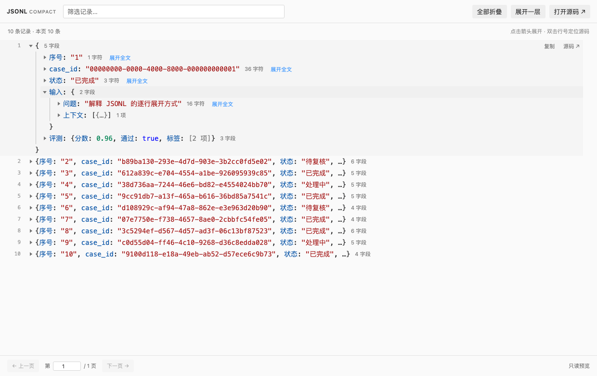

# JSONL Compact Viewer

**Version: 0.2.1** · **License: MIT** · **VS Code: 1.85+**

English | [简体中文](README.zh-CN.md)

A VS Code extension that displays JSON Lines as compact, expandable records, inspired by the object inspector in Chrome and Firefox DevTools. Each record starts on a single line; expand it in place to explore nested objects, arrays, and long strings.



## Features

- **Compact layout:** 24px rows by default, with no gaps between records.
- **Inline trees:** expand one record at a time and drill into individual fields.
- **Readable summaries:** preview the first few fields without expanding a record.
- **Full string inspection:** click a shortened string directly in an object/array summary to open that field's full text. Every string has explicit expand/collapse controls, including text clipped by a narrow pane.
- **Large-file support:** index file offsets in streaming chunks, then read only the requested page without requiring a VS Code text model.
- **Search and pagination:** filter the entire file by raw JSON text; browse up to 200 records per page by default, with smaller pages for large records.
- **Source navigation:** copy the original record or open its physical line in the text editor.
- **Faithful values:** preserve large integers, decimal precision, exponent notation, negative zero, and duplicate object keys.
- **Isolated errors:** a malformed line shows its error and source while other records remain usable.
- **Local processing:** no network requests, telemetry, CDN assets, or runtime dependencies.
- **Theme integration:** follows VS Code's light, dark, and high-contrast themes.

Supported extensions: `.jsonl`, `.ndjson`, and `.jsonlines`. The current viewer UI uses Simplified Chinese labels; the command title and documentation include English.

## Installation

Build a VSIX using the development instructions below, or download a matching `.vsix` from this repository's GitHub Releases page when releases are available.

1. Open the VS Code Extensions view: `Cmd+Shift+X` on macOS, or `Ctrl+Shift+X` on Windows/Linux.
2. Choose **… → Install from VSIX…**.
3. Select `jsonl-compact-viewer-0.2.1.vsix`.
4. Open a supported JSONL file.

If another editor is already the default, right-click the file and select **Open With… → JSONL Compact Viewer**. Use **Configure default editor…** to make this the default for that file type.

You can also run **JSONL: Open in Compact Viewer / 紧凑树形预览** from the Command Palette, or install from a terminal:

```sh
code --install-extension ./jsonl-compact-viewer-0.2.1.vsix
```

Version 0.2.1 is distributed as a local VSIX and is not published on the VS Code Marketplace.

## Usage

| Action | Behavior |
| --- | --- |
| Click a record's arrow or summary | Expand or collapse that record in place. |
| Click a nested arrow | Expand an object, array, or long string independently. |
| Click string text in an object/array summary | Open that record and reveal the selected string's full contents directly. |
| **展开全文** / **收起全文** | Expand or collapse a string's full text, including strings clipped only by the available pane width. |
| Hover over a record | Show **复制** (copy the original JSON line) and **源码** (open its source). |
| Double-click a line number | Reveal that physical line in the source editor. |
| **全部折叠** | Collapse all records on the current page. |
| **展开一层** | Expand the first level of each record on the current page. |
| Search box | Filter all records by raw JSON text, ignoring case. |
| `Cmd/Ctrl+F` | Search the content currently rendered in the webview. |
| **打开源码** | Open the source document in a text editor beside the viewer. |

Use `Tab` to focus nodes, `Enter` or `Space` to toggle them, left/right arrows to collapse/expand, and up/down arrows to move between visible nodes. Changes made in a text editor, including unsaved changes, update the preview automatically.

Expanded strings preserve the original text and line breaks. Long content wraps within the editor pane and has its own vertical scrollbar, so the complete value remains selectable without expanding every other record.

## Settings

Add these options to your VS Code `settings.json`:

```json
{
  "jsonlCompact.rowHeight": 24,
  "jsonlCompact.previewFields": 3,
  "jsonlCompact.pageSize": 200,
  "jsonlCompact.showLineNumbers": true
}
```

| Setting | Default | Description |
| --- | --- | --- |
| `jsonlCompact.rowHeight` | `24` | Row height in pixels, from 18 to 36. |
| `jsonlCompact.previewFields` | `3` | Fields shown in a collapsed summary, from 1 to 10. |
| `jsonlCompact.pageSize` | `200` | Maximum records per page, from 20 to 1000; file-backed pages also obey a byte budget. |
| `jsonlCompact.showLineNumbers` | `true` | Show physical line numbers from the source document. |

For a denser layout, set `jsonlCompact.rowHeight` to `20`.

## Data handling and limits

- This is a **read-only viewer**. Use **打开源码** to edit the source with VS Code's normal save and undo support.
- UTF-8 BOM, LF/CRLF line endings, blank lines, and JSON primitive records are supported. Blank lines are skipped; displayed line numbers still match the original file.
- Numbers are displayed from their original tokens. They are not converted to JavaScript numbers, so large IDs and decimal digits remain intact.
- Object and array children are rendered on expansion, in batches of up to 100 items.
- Local files, and file URIs on a remote workspace extension host, are indexed in 1 MiB chunks. The viewer uses its own read-only document and does not need VS Code to expose the complete file as a `TextDocument`. The status area reports indexing and search progress.
- The index keeps byte offsets and physical line numbers; its memory use grows with the number of non-empty records, rather than the size of their text. Requested records are read from disk on demand.
- File-backed pages are bounded by both the configured record count and an 8 MiB byte budget. Pages may contain fewer records when individual records are large; this keeps other valid records available on subsequent pages.
- A single record can preview up to 2 Mi characters and 8 MiB of UTF-8 data. Oversized records retain their physical line and a source action; whole-file search still checks their complete contents. Copying a record uses the same size limits.
- Unsaved changes in an open text editor use its current text snapshot. Non-file virtual filesystem resources without streaming support use a bounded fallback of up to 32 MiB.
- Opening the source uses VS Code's text editor and is subject to that editor's own large-file limits; the JSONL viewer can operate independently.
- File contents stay on the local machine or current remote workspace. Strings containing HTML or JavaScript are displayed as text.

## Development

Requirements: Node.js 18+, Python 3, and VS Code 1.85+. The required checks and packaging use built-in tools; no `npm install` is needed.

```sh
npm run check
npm test
npm run package
```

The package command generates `jsonl-compact-viewer-0.2.1.vsix` in the project root. On systems where Python is named differently, run `python scripts/package.py` or `py -3 scripts/package.py` directly.

Open this directory in VS Code and press `F5` to launch an Extension Development Host with `examples/sample.jsonl`.

See [CONTRIBUTING.md](CONTRIBUTING.md) for browser tests, extension-host tests, and release steps. [AGENTS.md](AGENTS.md) documents the repository conventions for coding agents.

## Contributing

Bug reports, feature proposals, and focused pull requests are welcome. Include a small synthetic or anonymized JSONL example when reporting a parsing or display issue. Read the [contribution guide](CONTRIBUTING.md) before making changes.

## Versioning

The current version is **0.2.1**. `package.json` is the version source of truth; VSIX filenames and manifests derive their version from it. Release tags use the `v0.2.1` format. Changes are recorded in [CHANGELOG.md](CHANGELOG.md).

## License

Released under the [MIT License](LICENSE).
