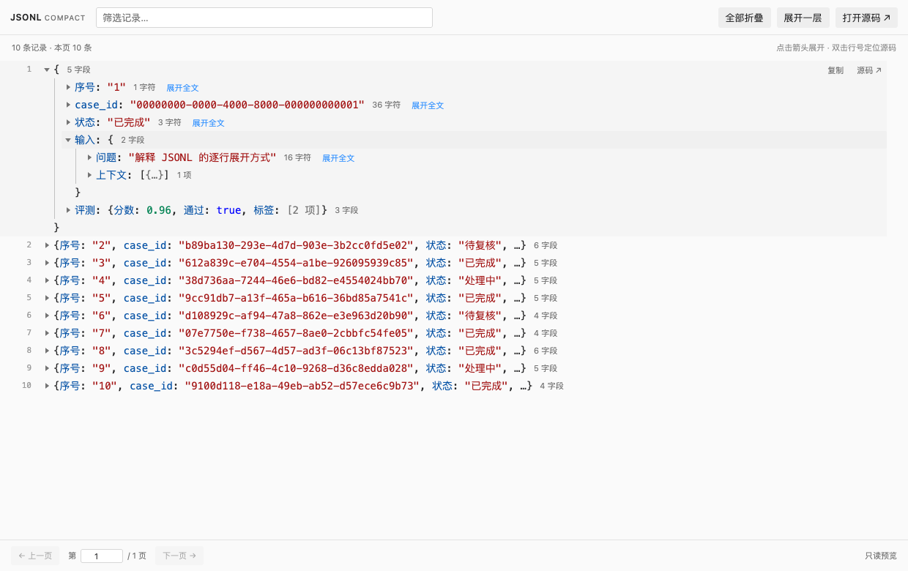

# JSONL Compact Viewer

**版本：0.2.1** · **许可证：MIT** · **VS Code：1.85+**

[English](README.md) | 简体中文

在 VS Code 中，把 JSONL 的每条记录显示成类似 Chrome / Firefox 开发者工具的一行对象摘要。点击原地展开，再逐层查看对象、数组和长字符串。多条记录紧密排列，默认行高 24px。



```text
  1  ▶ {序号: "1", case_id: "ea78aa1d-…", 状态: "已完成", …}
  2  ▼ {                                      6 字段
         序号: "2"
         case_id: "b89ba130-…"
       ▶ 输入: {问题: "保留长文本与中文", 上下文: []}   2 字段
       ▶ 输出: "这是第一段回答。\n这里是第二段…"       37 字符
       ▶ 评测: {分数: 0.82, 通过: true, 备注: null}      3 字段
       }
  3  ▶ {序号: "3", case_id: "612a839c-…", 状态: "已完成", …}
```

## 安装

1. VS Code 打开扩展面板（macOS：`Cmd+Shift+X`；Windows/Linux：`Ctrl+Shift+X`）。
2. 点击扩展面板右上角 `…` → **Install from VSIX… / 从 VSIX 安装…**。
3. 选择 `jsonl-compact-viewer-0.2.1.vsix`。
4. 打开 `.jsonl`、`.ndjson` 或 `.jsonlines` 文件。

如果已经为 JSONL 设置过其他默认编辑器，右键文件 → **Open With… / 打开方式…** → **JSONL Compact Viewer**。通过 **Configure default editor… / 配置默认编辑器…** 可以设为默认。

也可以在命令面板运行 **JSONL: Open in Compact Viewer / 紧凑树形预览**，或在终端安装：

```sh
code --install-extension /绝对路径/jsonl-compact-viewer-0.2.1.vsix
```

## 交互

- 点击记录左侧箭头或摘要：原地展开/折叠；嵌套字段也有独立箭头。
- 字符串摘要：直接点击折叠对象或数组中的字符串，可打开对应字段的全文。
- 字符串字段：点击内容或「展开全文 / 收起全文」按钮切换全文显示。因窗口较窄而显示省略号的短字符串也可展开；完整内容保留换行并自动折行，超长文本可在区域内滚动和选中复制。
- 悬停记录：显示「复制」（原始整行 JSON）和「源码」（在旁边定位原文件）。双击行号也可定位。
- 「全部折叠」与「展开一层」作用于当前页；展开的字段会在切换页面时保留。
- 搜索框按原始 JSON 文本筛选整个文件，不区分大小写。`Cmd/Ctrl+F` 则使用 VS Code 的查找组件搜索当前已渲染的内容。
- 键盘：`Tab` 聚焦，`Enter`/`Space` 展开折叠，左右方向键展开/折叠，上下方向键移动。
- 原文件在其他文本编辑器中修改时，预览会自动更新，包括未保存的更改。

## 设置

在 VS Code 的 `settings.json` 中按需调整：

```json
{
  "jsonlCompact.rowHeight": 24,
  "jsonlCompact.previewFields": 3,
  "jsonlCompact.pageSize": 200,
  "jsonlCompact.showLineNumbers": true
}
```

行高范围 18–36px，摘要字段数 1–10，每页记录数上限 20–1000。文件页还受读取字节预算约束，记录较大时自动减少单页条数，其他记录放到后续页。每条记录初始折叠，无卡片外边距；需要更密集时将行高设为 20。

## 数据与限制

- 本版是只读查看器。需要编辑时点击「打开源码」，使用 VS Code 文本编辑器及其保存、撤销功能。
- 支持中文、UTF-8 BOM、LF/CRLF、空行、对象、数组和 JSON 基本类型。空行跳过，行号始终对应原文件。
- 无效 JSON 只影响所在记录，会显示错误和原文，其他记录继续可用。
- 数字以原始文本显示，保留 64 位整数、小数精度、指数写法和负零；重复键也保留展示。
- 按页传入界面；对象和数组的子节点在展开时才创建，每批最多显示 100 项。
- 本地文件，以及远程工作区扩展宿主上的文件 URI，使用独立只读文档，按 1 MiB 分块建立行索引，按页读取。无需 VS Code 向扩展提供完整 `TextDocument`，状态栏会显示索引和搜索进度。
- 索引只保留字节偏移和物理行号，内存占用随非空记录数增长，不缓存整个文件的文本。翻页时按需读取对应记录。
- 文件页同时受条数上限和 8 MiB 字节预算约束，避免较大的记录导致同页后面的有效记录无法预览。
- 单条记录最多预览 2 Mi 字符及 8 MiB UTF-8 数据；超出时保留该行位置并提供源码入口。全文搜索仍会检查这些超大记录的完整内容，复制单条记录使用相同大小限制。
- 文本编辑器中已有的未保存更改使用当前文本快照；不支持流式读取的非文件虚拟资源使用最多 32 MiB 的有界回退方式。
- 「打开源码」使用 VS Code 文本编辑器，其大文件限制独立于此查看器。
- 文件只在本机或当前远程工作区处理；无网络请求、遥测、CDN、运行时第三方依赖。JSON 字符串作为文本显示，不执行其中的 HTML 或脚本。

## 本地开发与打包

需要 Node.js 18+、Python 3 和 VS Code 1.85+。无需 `npm install`。

```sh
npm run check
npm test
npm run package
```

在 VS Code 中打开此项目，按 `F5` 启动隔离的扩展开发窗口并查看 `examples/sample.jsonl`。

`scripts/package.py` 使用 Python 标准库生成 VSIX；也可以用官方工具 `npx @vscode/vsce package --no-dependencies --allow-missing-repository` 打包。

## 贡献与版本

欢迎提交 Issue 和 Pull Request。请使用合成或匿名化的 JSONL 示例描述问题。开发、测试与发布约定见 [CONTRIBUTING.md](CONTRIBUTING.md)，代理协作规范见 [AGENTS.md](AGENTS.md)。

当前版本为 **0.2.1**，以 `package.json` 为版本来源；VSIX 文件名和清单自动使用该版本，Git 发布标签采用 `v0.2.1` 格式。版本变更见 [CHANGELOG.md](CHANGELOG.md)。

## 许可证

使用 [MIT License](LICENSE)。当前为本地安装包，未发布到插件市场。
